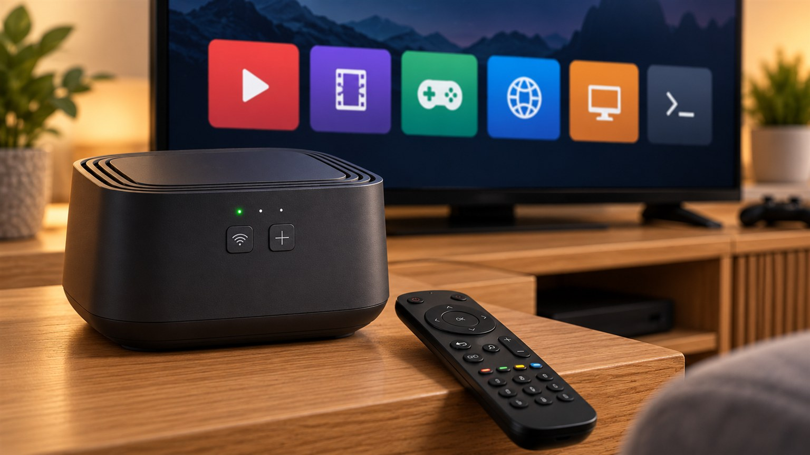
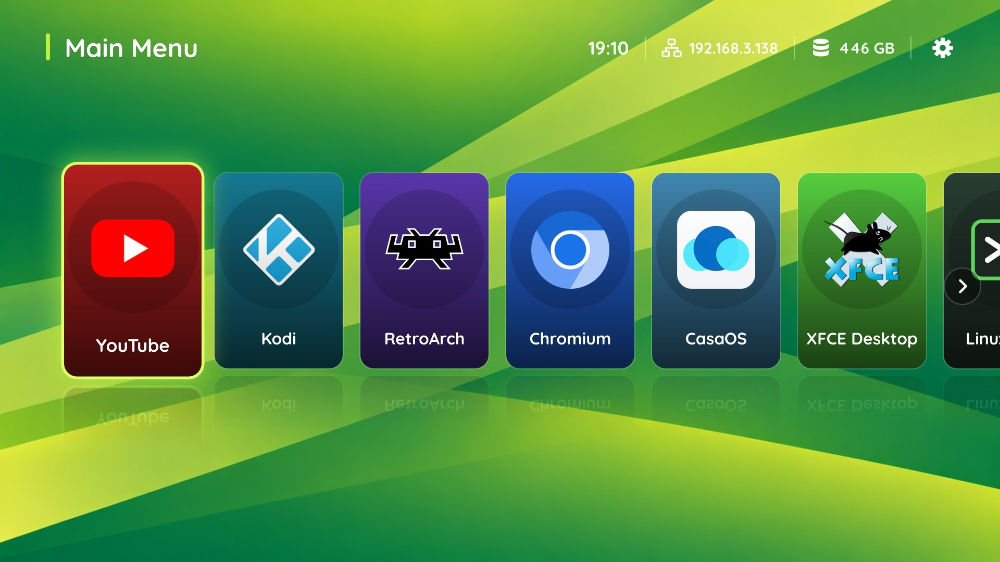

# MagentaTV Box Linux

Debian 12 for the Telekom **MagentaTV Box PLAY/PRO** (board MRG5, black 40868871 / white 40868874):
a second life for a set-top box that the operator has retired.

Telekom has moved MagentaTV to the MagentaTV 2.0 platform and is replacing the old boxes with
MagentaTV One. The older MagentaTV Box has reached end of life: its servers are shut down, and
the box now boots only to a "cannot log in" screen. Customers who get a new box
[do not have to return the old one](https://www.telekom.com/de/konzern/details/faktencheck-neues-magentatv-1098320).
So by the end of 2026 many thousands of these boxes will become electronic waste, even though the
hardware is still decent: four ARM cores, GPU, 4 GB of RAM, HDMI, Gigabit Ethernet, Bluetooth and, in one of the
two versions, a 500 GB hard disk.

This repository lets you keep using the box as a **YouTube / Kodi / RetroArch station**, a small
**NAS**, or a general-purpose **Debian 12 computer**.

Software video decoding on the CPU is enough to watch 720p movies. The four CPU cores and the
GPU are enough to emulate game consoles up to the PlayStation 1 (a DualShock 4 wireless
controller can be paired).

## What works

| | |
|---|---|
| Boot | from a USB stick, or from the internal eMMC without a stick |
| System | Debian 12 (armhf) on our own Linux 6.18 kernel, all four CPU cores, 4 GB RAM |
| Video | HDMI at 1080p50, framebuffer console, X11; 3D GPU (Broadcom V3D) with OpenGL ES 3.0. Video is decoded on the CPU: YouTube (TV interface) at 720p, Kodi and mpv |
| Sound | HDMI audio, as an ordinary ALSA sound card (PulseAudio); Bluetooth headphones and speakers |
| Remote | the original MagentaTV Bluetooth remote works as a keyboard: arrows, OK, Back, Home, volume keys; Power puts the box into soft standby. USB or Bluetooth  keyboards and mice work too |
| Bluetooth | game pads, headphones and other devices paired from the launcher's settings dialog |
| Game pads | DualShock 4, DualShock 3, Xbox and other Bluetooth or USB game pads |
| Games | RetroArch with cores for NES, SNES, Game Boy, GBA, Mega Drive, PC Engine, PlayStation, N64 and PSP; the free games from RetroArch's Content Downloader: Doom and Wolfenstein 3D shareware, the Quake II demo, ScummVM's freeware adventures; Quake (the shareware is downloaded on first start); Luanti |
| Storage | internal SATA hard disk, eMMC, USB storage |
| Network | Gigabit Ethernet; the data folder shared over SMB (`\\<box IP address>\DATA`); Docker with CasaOS (USB Boot and EMMC + internal HDD) |
| Casting and music | DLNA receiver, Spotify Connect, AirPlay, DLNA media server |
| TV launcher | a full-screen menu for the remote |
| Phone control | phone as touchpad and keyboard |
| Other | front LEDs show start-up and network state; soft standby from the remote's Power key |

Not supported: DRM and content protection (streaming services that need Widevine), the MagentaTV
service itself, hardware video decoding (the chip's video decoder has no Linux driver), Chrome's
*Cast*

## How to install

> [!WARNING]
> **Do this at your own risk.** The author is not responsible for any damage to your device or
> loss of data.

There are 3 different releases:

| Release | Description |
|---|---|
| **USB Boot** | Starts from a USB stick / USB SSD / USB HDD and changes nothing in the box. The programs and the data folder (`/DATA`: films, music, games, downloads) are on the USB drive; the box's internal HDD is not used. Includes CasaOS (web dashboard, apps, shared folders). Remove the USB drive, and the box starts its original software again. |
| **EMMC Only boot** | Installs the system onto the box's internal memory (eMMC); afterwards the box starts without a stick. The programs and the data folder are both on the eMMC. No CasaOS and no shared folders. Meant for a box **without an internal HDD**, or with the HDD removed or unused: an HDD in the box is never touched. |
| **EMMC + internal HDD** | Installs the system onto the eMMC as a read-only base, and puts everything that changes on the internal HDD: installed programs, services and their logs, settings, and the data folder. The eMMC is not written during use. Includes CasaOS. For a generic Linux machine and NAS. |

**Try USB Boot first, before anything else.** It changes nothing in the box, so it is the safe
way to check that everything works with your box and TV before you install anything onto the
eMMC.

### Writing a release to a stick

1. Download the release's `.img.xz` file from
   [Releases](https://github.com/RomanLut/magentatv-box-linux/releases).
2. Open [Raspberry Pi Imager](https://www.raspberrypi.com/software/). Under *Operating System*,
   choose *Use custom* and select the `.img.xz` file. Under *Storage*, choose the USB stick
   (for USB Boot also a USB SSD or USB HDD). Everything on it is erased.
3. Write the image, then eject the drive.

| Release | USB drive needed |
|---|---|
| **USB Boot** | at least **8 GB** (the image is 6 GB); **32 GB or more** recommended, because your programs, games and films are stored on it too. A USB SSD or USB HDD is better still |
| **EMMC Only boot** and **EMMC + internal HDD** (installer) | at least **4 GB** (the image is 1.7 GB) |
| **Uninstall** | any USB stick (the image is 0.3 GB) |

> [!NOTE]
> **Some USB HDDs may not work for USB Boot.** At power-on the box looks for a USB drive only
> briefly. A hard disk that is powered from the box's USB port is often still spinning up then, so
> the box does not find it and starts its original software instead. A USB HDD with its own power
> supply (or on a USB hub with a power supply), already running when you plug in the box's power,
> has the best chance. 

### Starting the box

1. Unplug the box's power, plug the stick into the box's USB port, and plug the power back in.
2. **USB Boot:** the launcher starts. The first start shows the remote pairing screen: hold the
   remote's button with the red icon until its LED blinks green.
3. **EMMC releases:** the TV shows the installer.
   - After a 30-second countdown, the installation takes about 10-15 minutes. To cancel, unplug
     the power during the countdown.
   - The middle front LED blinks green while it works, and turns steady green when it is done. It
     turns red on an error, and the TV then shows why.
   - When the TV says *installed*: unplug the power, remove the stick, and plug the power back
     in. The box now starts from the eMMC and shows the remote pairing screen.

After you plug in the power, the TV shows no picture for about 30 seconds. This is normal.

> [!WARNING]
> **Installing EMMC + internal HDD release formats the internal HDD.** Everything on it is erased.
> Back up any data on the HDD before you install.

| Login | User / password |
|---|---|
| Console (the *Linux Shell* tile), SSH, `sudo` | `admin` / `admin` |
| CasaOS (USB Boot and EMMC + internal HDD) | `user` / `user12345` |

CasaOS is at `http://<box IP address>/` (port 80) in a browser on your network, or from the
launcher's *CasaOS* tile.

The data folder `/DATA` (on the USB drive with USB Boot, on the internal HDD with EMMC + internal
HDD) is shared on the network over SMB as `\\<box IP address>\DATA`: guest access, no password,
read and write. Open it in Windows Explorer or any file manager to copy films, music, photos,
games and ROMs to the box. The EMMC Only release has no shared folder.

### Front LEDs

| LED | Meaning |
|---|---|
| Middle, green blinking | the box is starting |
| Middle, steady green | started |
| Middle, red | standby |
| Left, red | no IP address yet |
| Left, green | the box has an IP address |

With a Wi-Fi connection it takes several minutes until the box has an IP address.

### Why USB Boot does not use the internal HDD

If the USB drive is removed, the box starts its original firmware again. After three
unsuccessful boots, its recovery process starts, and it **formats the internal HDD**: all data
on it would be lost. That is why USB Boot keeps everything on its USB drive and never uses the
internal HDD.

If you do not want the EMMC + internal HDD setup but would like to use the box's HDD: take it
out of the box, connect it through a USB-SATA adapter, and use it as the USB drive for USB Boot
(give it its own power; see the note on USB HDDs above).

### Uninstalling an EMMC release

An EMMC release erases the original MagentaTV software on the eMMC, and stores one setting in the
box's boot flash: the variable `STARTUP`, which makes the box start from the eMMC. 

> [!CAUTION]
> **The recovery of the original firmware erases the internal HDD.** It formats the whole disk
> for the MagentaTV software, so everything on it is lost: the data folder, and any system
> installed there. Remove the HDD from the box, or copy what you need, before you uninstall.

To uninstall:

1. Write the uninstall image to a USB stick (see *Writing a release to a stick* above).
2. Unplug the box's power, plug the stick in, and plug the power back in. The stick removes the
   `STARTUP` setting from the boot flash, and the TV then shows *Uninstall done*. If it shows
   *Uninstall FAILED*, unplug the power and start the box with the stick again.
3. Unplug the power, remove the stick, and plug the power back in. Leave every other USB drive
   with a system on it out of the box too: a stick with a system on it still starts first.
4. Give the box half an hour. It no longer finds a system on its eMMC and tries to restore the
   original firmware from the internet, if the operator's servers can still be reached. All
   this time the TV shows no picture.

## Wear of USB sticks and the eMMC

Flash memory, like USB sticks and the eMMC, wears out with every write. The system is set up to
write as little as possible:

- logs, temporary files and program caches are kept in memory, not on the flash;
- the file system writes its changes in batches, every 10 minutes;
- the system itself writes well under 1 GB a day.

**Programs you install yourself can undo that.** Many services write logs and databases all the
time: download clients, media servers, home automation, security cameras. On a USB stick or on
the eMMC they wear it out, sometimes within months.

- **USB Boot needs its USB drive in the box all the time,** in its only USB port. A cheap stick
  can wear out or drop out. You can add a USB hub for a keyboard, but use one with its own power
  supply.
- **USB Boot** is also fine for heavy use if you use a **USB SSD or USB HDD** instead of a stick:
  these take many more writes. The box's own internal HDD in a USB-SATA adapter can be used too
  (but see the note on USB HDDs above).
- **USB Boot or EMMC Only boot** are recommended if you are not going to install further software
  and will use the box as a YouTube and Kodi station.
- **EMMC + internal HDD** is recommended if you want a generic Linux machine and NAS. In this
  setup **everything that is written goes to the HDD**, so the software you install cannot wear
  out the eMMC.

## Details

- [Hardware](hardware.md): specification and photos of the board and its parts.
- [The secure boot process](boot_process.md): how the box boots, and how Linux gets to run on it.
- [Wi-Fi pairing](wifi_pairing.md): connecting the box to your Wi-Fi with its front buttons.
- [Building from source](BUILDING.md): the kernel, the drivers and the release images, and how they are built.

## How the project was started

This is a personal research project to find out how well AI agents can do reverse engineering.
The results speak for themselves: from zero knowledge of the device to a fully working system in
two weeks, without a single line of code written by a human. Before, a project like this would
have taken a year or more, if anyone had thought it possible at all.

This repository does not contain any binary files from the original system. All software and
drivers are based on open-source software, plus firmware that chip makers publish themselves
(such as Realtek's Bluetooth firmware). The original system was reverse engineered only to find
out hardware details.

## Support this project

Your box was on its way to the scrap heap. Now it plays YouTube, runs Kodi and RetroArch, and
serves files to your home network.

If this project gave your box a second life - please consider buying me a coffee.

  

No coffee money? A ⭐ star on GitHub helps too: it lets other owners of these boxes find the project.

