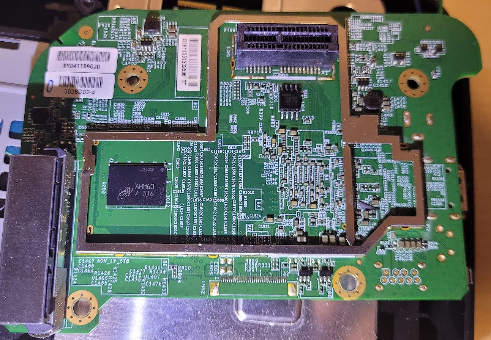
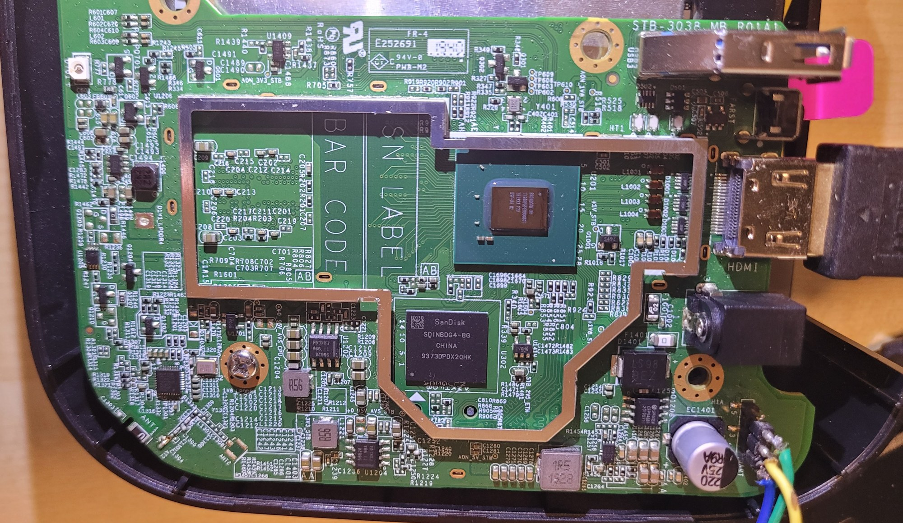
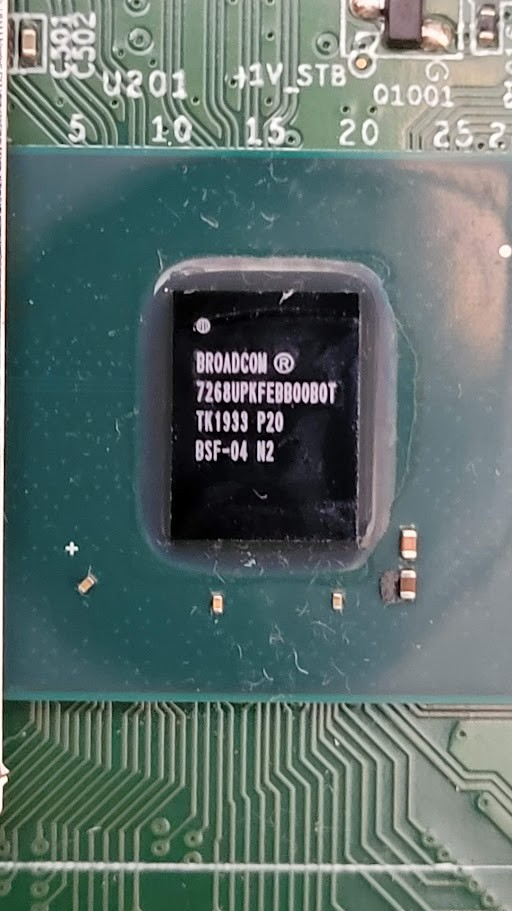
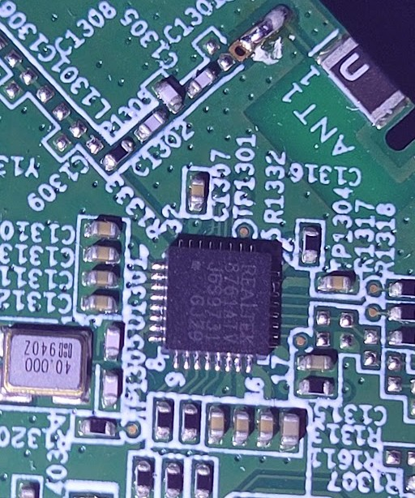
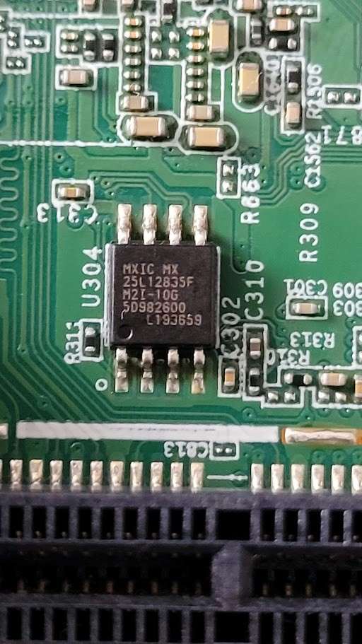
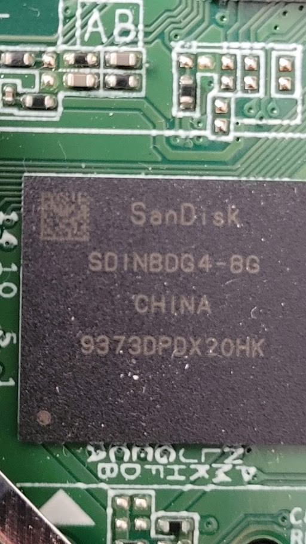
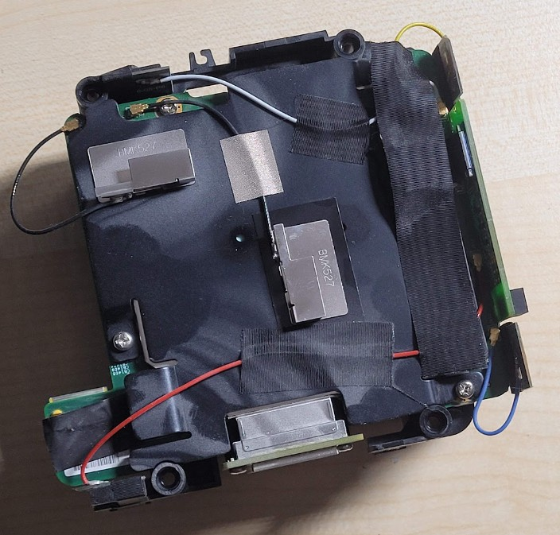
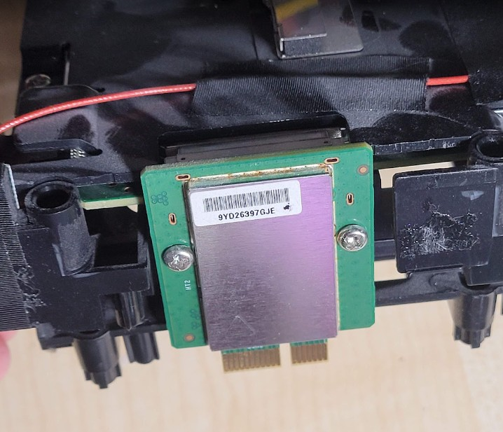

# MagentaTV Box hardware

Specification and photos of the MagentaTV Box (board MRG5, black variant 40868871) and its main
parts.

## Specification

The box was sold in two versions: with a 500 GB 2.5" hard disk, and without one.

| Part | Details |
|---|---|
| SoC | Broadcom BCM7268: 4 × ARM Cortex-A53 (Brahma-B53). The boot loader starts kernels in 32-bit mode only, so the system is 32-bit ARM (armhf) |
| GPU | Broadcom VideoCore V3D |
| RAM | 4 GB |
| Boot flash | 16 MB SPI NOR, Macronix MX25L12835F (boot loaders; not modified by this project) |
| eMMC | 8 GB, SanDisk SDINBDG4-8G |
| Hard disk | 500 GB 2.5" SATA drive in a removable caddy (SATA 6 Gbps), only in the version with a hard disk; other 2.5" drives work too |
| Ethernet | 1 × Gigabit (Broadcom GENET) |
| Wi-Fi | dual-band 4×4 802.11ac mesh module (Arcadyan). It is a separate module with its own firmware, connected to the Ethernet side through an internal switch; Linux does not control it |
| Bluetooth | Realtek RTL8761ATV (Bluetooth 4.2), used for the remote |
| Video out | HDMI 2.1 |
| USB | 1 × USB 3.0 |
| Front panel | 3 LEDs driven by a small microcontroller; rear "Reset" button (a plain input, not a hardware reset) |
| Service port | 3.3 V UART, 115200 8N1, on the board |
| Power | 19 V DC, 2 A external supply; under 14 W in use; passive cooling |
| Size, weight | 148 × 87 × 148 mm, about 840 g |

## Main board

### Top side

- **Top centre, `CON1`:** the board-to-board connector to the network/Wi-Fi board. It is shaped
  like a PCIe card-edge socket, but it carries the SoC's Ethernet link (RGMII) to the network
  switch on the other board. The RJ45 socket, the Ethernet PHY and the Wi-Fi module are all on
  that board (see [Wifi board](#wifi-board)).
- **Below `CON1`, `U304`:** the SPI NOR boot flash, Macronix MX25L12835F (16 MB, 8-pin SOP). It
  holds BFW, BLS1 and BLS2 (see [Boot flash](#boot-flash)).
- **Middle left, `U202`:** a Micron RAM chip, FBGA code `D9WHV`.
- **Left edge:** the SATA connector for the hard-disk caddy.
- **Bottom centre, `CON2`:** a flat-cable (FPC) connector.
- The metal frames are the bases of the shield covers, which are removed here.

### Bottom side

The board is marked `STB-3038_MB R01A1`.

- **Centre right, `U201`:** the Broadcom BCM7268 SoC (see [SoC](#soc)).
- **Below it, `U302`:** the eMMC, SanDisk SDINBDG4-8G (8 GB) (see [eMMC](#emmc)).
- **Lower left:** the Bluetooth chip, Realtek RTL8761ATV (QFN), next to its 40.000 MHz crystal.
  `ANT1` and `ANT2` at the board edge are its antennas.
- **Right edge, top to bottom:** USB 3.0 port, HDMI socket, 19 V DC power socket.
- **Bottom right:** the service UART header, here with three wires soldered on (see
  [Service UART](#service-uart)).

### SoC

`U201`, the Broadcom BCM7268 (marked `BROADCOM 7268UPKFEBB0B0T`), on the bottom side. It has
four ARM Cortex-A53 (Brahma-B53) cores, the VideoCore V3D GPU, the video and display pipeline,
HDMI output, Gigabit Ethernet MAC, SATA, USB and eMMC controllers. The boot loader starts
kernels in 32-bit mode only, so the system runs 32-bit ARM (armhf).

### Bluetooth

The Realtek RTL8761ATV Bluetooth 4.2 controller, with its 40.000 MHz crystal on the left and the
`ANT1` antenna at the top right. It talks to the SoC over a UART (`ttyS1`) and connects the
original MagentaTV remote.

### Boot flash

`U304`, a Macronix MX25L12835F (marked `MXIC MX 25L12835F M2I-10G`): 16 MB SPI NOR flash
on the top side, just above the board-to-board connector `CON1`. It holds the boot chain (BFW,
BLS1, both BLS2 copies) and the boot loader's settings. The project leaves the boot code in it
untouched.

### eMMC

`U302`, a SanDisk SDINBDG4-8G: 8 GB eMMC on the bottom side, next to the SoC. The stock system
keeps its encrypted kernel and file system here. This project reuses one of its partitions to
boot Linux without a USB stick.

## Hard disk
 500 GB 2.5" SATA drive in a removable caddy (SATA 6 Gbps), only in the version with hard disk; other 2.5" drives work too.

## Service UART

3.3 V, 115200 8N1. Attach the adapter's RX lead only after power-on: if it is  connected while the box powers up, it pulls a boot strap and the hard disk does not  spin up.

## Reset buttons

There are two reset buttons on the back panel. Telekom's manual calls them **Reset (TV)** and
**Reset (WLAN)**.

- **Reset (TV), on the main board next to the USB port.** On the original device it reset the
  MagentaTV settings (held while plugging in the power, it restored the software). It is not a
  hardware reset: it is a plain input to the SoC (GPIO 47, low while pressed), and pressing it
  does not restart the box. In this project, holding it for 3 seconds while the TV launcher is
  shown opens the remote pairing screen.
- **Reset (WLAN), on the Wi-Fi board.** It resets the Wi-Fi board's network settings to factory
  defaults and works as on the original device (see [Wi-Fi pairing](wifi_pairing.md)). Linux on
  the main board does not see it.

## Wifi board

No effort was made to reverse engineer this board. This project uses it as it is.

The box is really two devices in one case. Besides the main board, there is a second board
with its own processor and firmware, made by Arcadyan for Deutsche Telekom (the ODM behind
Telekom's Speedport routers). It holds:

- the dual-band 4×4 802.11ac Wi-Fi module;
- a network switch;
- the Ethernet PHY and the RJ45 socket.

The Wi-Fi board assembly with its antennas: metal plate antennas (marked `BMK527`) on the
plastic frame, connected to the board by thin coaxial cables.

The inter-board card. Its card edge (bottom) plugs into `CON1` on the main board, and the
connector at its top joins the Wi-Fi board. What sits under its metal shield was not examined.

The main board has no Ethernet socket or PHY of its own. The SoC's Gigabit Ethernet MAC connects
to the switch on this board through the board-to-board connector `CON1` (RGMII, fixed 1 Gbps
link). The switch connects the SoC, the Wi-Fi module and the RJ45 socket.

Linux on the main board cannot see or control the Wi-Fi module and needs no Wi-Fi driver. For
the SoC there is only an Ethernet port (`eth0`). The module keeps working no matter what the
SoC runs, including our own Linux.

### IP addresses

The Wi-Fi module and the SoC are two separate devices on your network. Each has its own MAC
address (on the tested box, the Wi-Fi module's MAC is the SoC's plus 2) and gets its own address
from your router by DHCP:

- **the SoC (Linux):** the box's own address, shown in the top bar of the TV launcher;
- **the Wi-Fi module:** a second address, where it serves its own web interface on port 80
  (an Arcadyan login page). Look it up in your router's list of connected devices.

### Wi-Fi

When the module is joined to your Wi-Fi network, it bridges it to the internal switch, so Linux
gets network access with no cable. Joining happens in the module's own web interface (or with
Telekom's mesh pairing), not in Linux.

The module can also extend your Wi-Fi network. It was designed as a Telekom Mesh access point:
it joins your network and extends it, so other devices nearby can connect through it.
